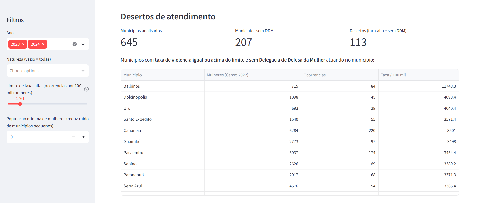
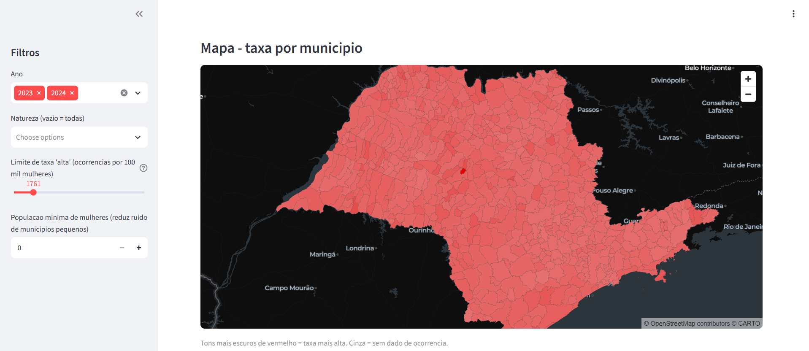

# 🗺️ Mapa da Violência Contra a Mulher — São Paulo

Projeto desenvolvido durante o hackathon de **Segurança Pública**, promovido em parceria com a **AWS** e a **Estácio**, utilizando o **Kiro** como ferramenta de apoio ao desenvolvimento. A solução é um painel interativo que mapeia e analisa a violência contra a mulher nos 645 municípios do estado de São Paulo, cruzando a taxa de ocorrências (por 100 mil mulheres) com a presença de Delegacia de Defesa da Mulher (DDM) para revelar os chamados **"desertos de atendimento"**: municípios com taxa alta de violência e sem delegacia especializada.

---

## 👥 Equipe

**Nome do grupo:** Equipe 7

**Integrantes:**
- Rodrigo Oliveira - 202403911426
- Elias Almeida - 202403915091
- Renzo Miranda - 202601737252
- Mario Lucas - 202603574687

---

## 📌 Sobre o Projeto

A violência contra a mulher é um problema social grave e desigualmente distribuído pelo território. Boa parte das políticas de enfrentamento depende de estrutura de atendimento especializado — em especial as Delegacias de Defesa da Mulher (DDM) —, mas essa rede não cobre todos os municípios de forma homogênea. O projeto parte de uma pergunta simples: **onde há mais violência registrada e, ao mesmo tempo, menos estrutura especializada de atendimento?**

Para responder, o painel reúne dados públicos oficiais, calcula a taxa de ocorrências por 100 mil mulheres de cada município e a cruza com a existência de DDM, destacando os municípios mais vulneráveis. A solução foi idealizada e desenvolvida no contexto do hackathon de Segurança Pública, em parceria com a AWS e a Estácio, com o apoio do Kiro no processo de desenvolvimento.

---

## 🎯 O que foi criado?

Um **painel web interativo** com os seguintes recursos:

- **Indicadores-resumo:** total de municípios analisados, municípios sem DDM e quantidade de "desertos de atendimento".
- **Lista de "desertos de atendimento":** municípios com taxa de violência igual ou acima de um limite configurável **e** sem Delegacia de Defesa da Mulher atuando no território.
- **Mapa coroplético** do estado de São Paulo, colorindo cada município conforme a taxa de violência (tons mais escuros = taxa mais alta; cinza = sem dado), com *tooltip* de município, taxa e presença de DDM.
- **Filtros interativos:** por ano, por natureza da ocorrência, por limite de taxa "alta" e por população feminina mínima (para reduzir o ruído de municípios muito pequenos).
- **Tabela completa** com todos os municípios: população feminina, ocorrências, taxa por 100 mil e presença de DDM.
- **Avisos permanentes** sobre subnotificação e os canais oficiais de ajuda (Ligue 180 e 190).

Além do painel, o projeto inclui um **pipeline de dados reprodutível**: scripts que baixam, validam e agregam os dados automaticamente a partir das fontes oficiais.

---

## 👤 Quem vai utilizar?

- **Gestores e órgãos públicos** de segurança e de políticas para a mulher, para priorizar a expansão da rede de atendimento.
- **Pesquisadores e jornalistas** que analisam violência de gênero e distribuição de serviços públicos.
- **Organizações da sociedade civil** e coletivos de apoio à mulher.
- **Cidadãos** interessados em entender a realidade do seu município.

---

## ⚙️ Como será utilizado?

O usuário acessa o painel pelo navegador, visualiza os indicadores e o mapa do estado e usa os filtros na barra lateral para recortar os dados por ano, tipo de ocorrência e porte do município. A partir da lista de "desertos de atendimento" e do mapa, consegue identificar rapidamente onde a demanda por atendimento especializado é alta e a estrutura é ausente. O painel é **meramente informativo e analítico** — não é um canal de denúncia nem de socorro.

---

## 🌍 Problema que buscamos resolver

Faltam ferramentas acessíveis que conectem, de forma visual e por município, **dois dados que normalmente vivem separados**: o volume de violência contra a mulher e a presença de estrutura especializada de atendimento. Sem esse cruzamento, fica difícil enxergar as lacunas de cobertura. O projeto torna essa desigualdade territorial visível, apoiando decisões baseadas em evidências.

---

## 💡 Objetivo e impacto esperado

O objetivo é **transformar dados públicos dispersos em um diagnóstico territorial claro** sobre violência contra a mulher e cobertura de atendimento. O impacto esperado é apoiar a conscientização, qualificar o debate público e oferecer subsídio para a priorização de investimentos onde a vulnerabilidade é maior.

---

## 📊 Dados e fontes utilizadas

Todos os dados são **públicos, oficiais e agregados por município** — sem dados individuais, sem identificação de pessoas e sem endereços de delegacias ou de casas-abrigo.

| Dado | Fonte / Instituição | Link | Período |
|------|--------------------|------|---------|
| População feminina por município | IBGE — Censo Demográfico 2022 (API SIDRA, tabela 9514) | https://apisidra.ibge.gov.br | 2022 |
| Malha municipal (geometria dos 645 municípios) | IBGE — API de Malhas Territoriais v4 | https://servicodados.ibge.gov.br/api/v4/malhas | 2022 |
| Ocorrências de violência contra a mulher e presença de DDM | SSP-SP — Portal da Transparência (Dados Criminais) | https://www.ssp.sp.gov.br/estatistica/consultas | 2023–2024 (anos disponíveis no portal) |

**Detalhes do tratamento dos dados:**
- As ocorrências consideradas "violência contra a mulher" foram restritas a naturezas predominantemente de gênero — **feminicídio, estupro, estupro de vulnerável, importunação sexual e violência doméstica** — porque o arquivo da SSP-SP não traz o sexo da vítima, o que impede isolar mulheres em crimes não-generados (por exemplo, lesão corporal). Essa restrição evita superestimar os números.
- A presença de **Delegacia de Defesa da Mulher (DDM)** foi derivada do próprio dataset da SSP-SP, identificando municípios onde atua uma delegacia cujo nome indica "Defesa da Mulher"/DDM.
- A **taxa por 100 mil mulheres** é calculada como `(ocorrências ÷ população feminina do município) × 100.000`.
- Os arquivos brutos da SSP-SP (que contêm dados individuais) são processados em *streaming*, agregados por município e **apagados automaticamente** ao final — apenas as contagens agregadas são gravadas.

---

## 🛠️ Tecnologias utilizadas

- **Python 3.11** — linguagem base do projeto.
- **Streamlit** — construção do painel web interativo.
- **pandas** — leitura, junção e agregação dos dados.
- **requests** — download dos dados das APIs e do portal da SSP-SP.
- **openpyxl** — leitura em *streaming* das planilhas XLSX da SSP-SP (arquivos de ~200 MB por ano).
- **pydeck** — renderização do mapa coroplético.
- **geobr / geopandas** — fallback para obtenção da malha municipal.
- **APIs IBGE** — SIDRA (população) e Malhas Territoriais v4 (geometria).
- **Kiro** — ferramenta de apoio ao desenvolvimento de software.

---

## 🚀 Como executar o projeto

```bash
# 1. Instalar as dependências
pip install -r requirements.txt

# 2. Gerar os dados (a partir das fontes oficiais)
python data/download_populacao.py     # população feminina (IBGE/SIDRA)
python data/download_malha.py          # malha municipal (IBGE)
python data/download_ocorrencias.py    # ocorrências + DDM (SSP-SP)

# 3. Iniciar o painel
streamlit run app.py
```

O painel abre no navegador em `http://localhost:8501` (ou na porta indicada no terminal).

> **Observação:** os scripts de download são tolerantes a falhas — se o download de um ano falhar, o erro e a URL tentada são exibidos e o processamento segue para os demais. Os arquivos de ocorrências da SSP-SP são grandes (~200 MB por ano), então o passo 2 pode demorar alguns minutos.

---

## 📸 Demonstração




 

---

## 🤖 Uso de Inteligência Artificial

O **Kiro** foi utilizado como ferramenta de apoio ao longo de todo o desenvolvimento:
- **Planejamento:** definição da arquitetura do painel e do pipeline de dados.
- **Pesquisa e descoberta de fontes:** localização das APIs do IBGE e do formato dos dados da SSP-SP.
- **Implementação:** escrita dos scripts de download/agregação e do `app.py`.
- **Testes e validação:** verificação da correção dos dados (ex.: conferência da população por município e do cruzamento de nomes SSP↔IBGE), além de testes do pipeline ponta a ponta.
- **Documentação:** elaboração deste README.

---

## ⚠️ Limitações e considerações

- **Subnotificação:** os números refletem apenas ocorrências **registradas** pela polícia. Grande parte da violência contra a mulher não é denunciada — taxas baixas podem indicar subnotificação, e não ausência de violência. Mais registros também podem significar **mais denúncias**, e não necessariamente mais violência.
- **Presença ≠ qualidade:** a existência de uma DDM indica cobertura, mas **não mede a qualidade** do atendimento prestado.
- **Cobertura temporal:** o período depende dos anos disponíveis no portal da SSP-SP; anos recentes podem estar incompletos.
- **Natureza dos crimes:** como a base não informa o sexo da vítima, a análise se concentra em crimes predominantemente de gênero, o que pode deixar de fora parte da violência doméstica registrada sob outras naturezas.
- **Municípios pequenos:** em municípios com poucas mulheres, poucos casos alteram muito a taxa por 100 mil; use o filtro de população mínima para contextualizar.

---

## 🏆 Sobre o Hackathon

- **Tema:** Segurança Pública — Mapa da Violência contra a Mulher
- **Instituições parceiras:** AWS e Estácio
- **Ferramenta de desenvolvimento assistido:** Kiro
- **Evento:** Hackathon AWS
- **Data:** 29/10/2026

---

Desenvolvido pela **Equipe 7** durante o hackathon de Segurança Pública, em parceria com a **AWS** e a **Estácio**, utilizando o **Kiro** como ferramenta de apoio ao desenvolvimento.

*Informação, tecnologia e conscientização para apoiar o enfrentamento da violência contra a mulher.*
